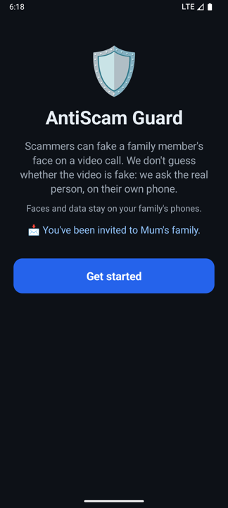
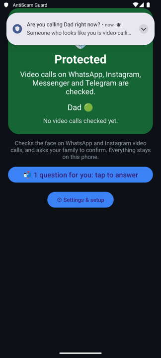
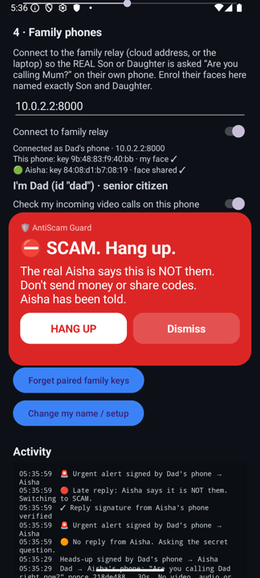

# Get started: try AntiScam Guard on your Android phones

This guide takes you from zero to a working family check: a video call that *looks* like a family member, their phone
asking "Are you calling Dad right now?", and a red **SCAM** warning when they say no.

<p align="center">
  
  &nbsp;
  
  &nbsp;
  
</p>

## Pick how you want to try it

| Option | You need | Time |
| --- | --- | --- |
| **A. Browser demo** | Any computer or phone with a browser | 2 minutes |
| **B. The real app on real phones** | 2 or more Android phones (Android 11+), plus a computer to run the relay | About 20 minutes |

---

## A. Browser demo (nothing to install)

Open **https://zihimm.github.io/AI-Powered_AntiScam_App/** in Chrome and allow the camera. Three phones are simulated on
one page: you enrol your face as "Son", start a call, and answer the question on Son's phone. See
[WEB-DEMO.md](WEB-DEMO.md) for a step-by-step script.

---

## B. The real app on real phones

### What you need

- **2 or more Android phones** with Android 11 or newer. A third phone (or any phone with WhatsApp) plays the "scammer".
- **WhatsApp, Instagram or Messenger** on the phone that will receive the call.
- **A computer to run the relay**, the small server the family's phones talk through. It never sees faces or video.

### Step 1: start a relay

The relay must be running before anyone creates a family. Get the code first:

```bash
git clone --branch jason/step2 https://github.com/ZiHimm/AI-Powered_AntiScam_App.git
cd AI-Powered_AntiScam_App
```

Use the `jason/step2` branch: its relay supports the family features in the app below.

Then pick **one** of these:

| Option | Best when | Commands |
| --- | --- | --- |
| **Same Wi-Fi** (simplest) | All phones and the computer are on the same Wi-Fi or hotspot | `cd mobile && npm install && npm run relay`. It prints an address such as `192.168.1.104:8000`. |
| **Anywhere, free** (Docker + Cloudflare) | Phones on different networks or mobile data, or Wi-Fi that blocks devices from seeing each other (common at venues) | `MONITOR_TOKEN=$(openssl rand -hex 16) docker compose -f mobile/relay/docker-compose.yml up -d --build`, then `docker compose -f mobile/relay/docker-compose.yml logs tunnel \| grep trycloudflare` shows an `https://….trycloudflare.com` address. |
| **Always on** (cloud host) | Longer tests | Fly.io or Railway: see [mobile/relay/README.md](../mobile/relay/README.md). |

Write down the address. Keep the computer **on, awake and online** while you test. With the Docker option, the address
changes whenever the tunnel restarts, and then you'd need to create the family again.

### Step 2: install the app on every phone

On each phone, open this link (or scan the QR code from your computer screen):

**[Download AntiScamGuard.apk (family preview)](https://github.com/ZiHimm/AI-Powered_AntiScam_App/releases/download/android-step2-preview/AntiScamGuard.apk)**


The app isn't on the Play Store yet, so Android will ask you to confirm:

1. Open the downloaded file. If asked, allow your browser to **install unknown apps**.
2. If **Google Play Protect** warns about an unknown app, tap **More details → Install anyway**. The app is built
   from this repository by [GitHub Actions](../.github/workflows/android.yml).

### Step 3: set up the family

**First phone (the person creating the family, e.g. Dad):**
1. Open the app and tap **Get started**.
2. Enter your name. Tick **I'm a senior citizen** if this person should have guardians, and **Check my incoming video
   calls** to protect this phone.
3. Tap **Create a new family** and paste the relay address from step 1.
4. Show the **QR code**, or tap **Send invite link** to share it on WhatsApp.

**Every other phone:**
1. Scan the QR code, or open the invite link and tap **Open AntiScam Guard and join**.
2. Enter your name (for example Aisha or Son).

**Everyone:**
- **Take 3 quick selfies** when asked. Only a set of numbers is kept, never the photos, and it's sent automatically
  to the rest of the family. The app shows "Sent to N family phone(s)".
- **Turn on protection** when the app asks (see the permissions below).

### Step 4: permissions (what they're for)

| Permission | Why the app needs it |
| --- | --- |
| **Accessibility** | To notice a video call and look at the caller's face. Screenshots are processed in memory and never saved or uploaded. |
| **Notifications** | So "Are you calling…?" questions and alerts can pop up. |
| **Battery: unrestricted** | So the phone doesn't stop the app in the background. |
| **Camera** | Only for your own selfies during setup. |
| **Fingerprint / screen lock** | To confirm your Yes or No answer. |

**Accessibility switch greyed out?** Android 13+ blocks this for apps installed outside the Play Store. Go to
**Settings → Apps → AntiScam Guard → ⋮ (top right) → Allow restricted settings**, then turn Accessibility on again.

**Phone-specific battery settings.** Some phones close background apps aggressively, which disconnects them from the family:

| Phone | What to change |
| --- | --- |
| Xiaomi / Redmi / POCO | App info → **Autostart: ON** and **Battery saver: No restrictions**. Also lock the app in Recent apps. |
| Samsung | Settings → Battery → Background usage limits → add AntiScam Guard to **Never sleeping apps**. |
| OnePlus / Oppo / Realme | App info → Battery → **Allow background activity**. |
| Huawei / Honor | Battery → App launch → AntiScam Guard → **Manage manually**, with all switches on. |

### Step 5: try the scam scenario

Say Dad's phone is protected and Aisha's face is shared with it.

1. On a **third phone**, show a photo or video of Aisha on a laptop screen, point the camera at it, and **video-call Dad
   on WhatsApp**.
2. Dad's phone recognises Aisha and shows **"Checking with Aisha…"** on top of the call.
3. Aisha's phone asks **"Are you calling Dad right now?"**. She taps **No** and confirms with her fingerprint.
4. Dad's screen turns red: **SCAM. Hang up.** If Dad is a senior, his guardians get an urgent alert.

Try the other outcomes too: tap **Yes** (green), or ignore the question (the family secret question appears).

---

## Troubleshooting

| Problem | Fix |
| --- | --- |
| Family members show ⚪ (offline) | Check the relay is still running and the computer is awake. For the Docker option, see whether the address changed (`docker compose … logs tunnel`). On the phone, allow unrestricted battery use (above). |
| "No face yet" for someone | That person should retake their selfies in the app (**🛡️ My protection**) with **This is me** ticked, or tap **🔄 Sync faces**. Both phones must be online. |
| Nobody is asked during a call | Make sure **Check my incoming video calls** is on and protection is switched on for the phone receiving the call. Hold the face steady and large in the frame. The app needs a clear match in 2 of 3 frames. |
| The question never pops up | Allow notifications for AntiScam Guard. The home screen shows a warning with a one-tap fix. |
| "Can't check this caller" | That app blocks screenshots on this screen. The app can't see the face, so it says so. |
| Accessibility can't be turned on | **Allow restricted settings** (see step 4). |

Still stuck? [Open an issue](https://github.com/ZiHimm/AI-Powered_AntiScam_App/issues/new/choose) with your phone model,
Android version, and the log. To get the log, connect the phone over USB and run `adb logcat -s AntiScamGuard`.

## Privacy and removal

- Faces are stored only as numbers, on the phones. The relay forwards small signed messages and never sees video, audio,
  photos or location.
- To remove everything, uninstall the app. Its keys, faces and settings are deleted with it.
